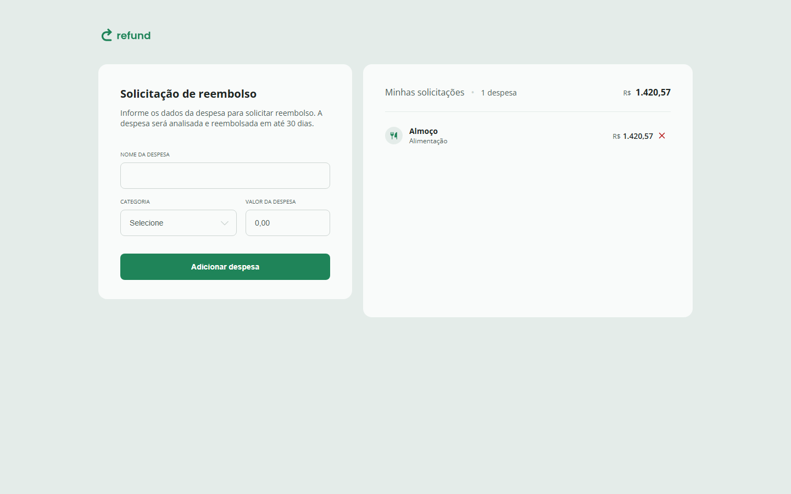

# Refound

O Refound é um projeto de front-end que simula o registro de despesas para reembolso. Você informa o nome, a categoria e o valor da despesa para adicioná-la à lista. Ao adicionar ou remover um item, a página atualiza a quantidade de despesas e o total em reais.

## Prévia

## Tecnologias usadas

| Tecnologia | Por que foi usada |
| --- | --- |
| HTML | Estrutura o formulário e a lista de despesas. Os campos obrigatórios usam a validação nativa do navegador. |
| CSS | Define a aparência da interface. Flexbox organiza os blocos, e as media queries adaptam o layout para telas menores. |
| JavaScript | Captura os dados do formulário, formata os valores em reais e atualiza a lista, a quantidade e o total sem recarregar a página. |
| SVG | Exibe o logotipo e os ícones das categorias com nitidez em diferentes tamanhos. |
| Google Fonts | Carrega a fonte Open Sans usada na interface. |

## Como executar

Abra o arquivo `index.html` no navegador. O projeto roda diretamente no navegador, sem instalação de dependências. As alterações na lista duram até a página ser recarregada.
